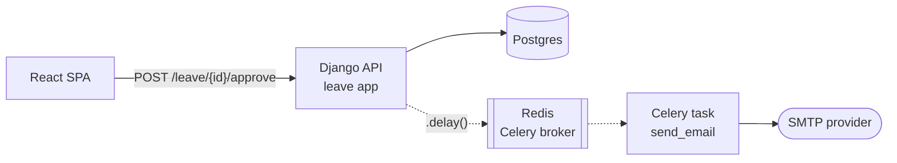
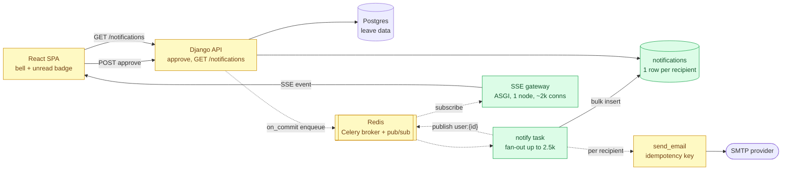

# Design brief: Leave-request notifications

> Example output of the `system-design-first` skill for the prompt:
> *"We need in-app and email notifications when a leave request is approved.
> 20k employees, 300 companies. The PM wants the bell to update 'instantly'."*
> Stack: Django + Postgres + Celery (Redis broker, emails only) + React SPA.
> Open [`architecture.html`](architecture.html) in a browser for the diagrams.

**Depth:** L2 · **Status:** proposal · **Author's intent:** bell icon with unread count plus email, reuse what we have, push for mobile later.

## 1. Scope

Functional: on leave approved / rejected, ATS stage change and signature request, the affected employees get an in-app notification (bell, unread count, list, mark as read) and an email.
Non-functional (inferred): bell updates within ~2 s of the event; email within a minute; no duplicate emails on retries; tenant isolation on every read; nothing breaks if the real-time channel is down (the list still loads).
Out of scope: mobile push (Phase 3), user notification preferences, digests.
Assumptions: one event reaches at most one company (≤ 2,500 people); 25 % of DAU keep a tab open at the 9:00 peak.

## 2. Estimates

| Metric | Now | +12 months | Source |
| --- | --- | --- | --- |
| Tenants / employees | 300 / 20k | 450 / 40k | stated / assumed 2× |
| Notifications + emails / day | ~5k + ~5k | ~10k + ~10k | 1 event per 4 users per day |
| Worst fan-out | 1 → 2,500 | 1 → 5,000 | largest company |
| Open tabs at the 9:00 peak | ~2k | ~5k | 25 % of DAU |
| Polling every 5 s instead | 400 rps of empty queries | 1,000 rps | 2k tabs / 5 s |
| Storage | ~1 MB/day | ~2 MB/day | ~200 B/row |

Conclusion: throughput is a non-issue at every layer, so no Kafka and no separate service. What shapes the design: one click fans out to 2,500 rows and emails; "instantly" means long-lived connections, not polling; Celery over Redis is at-least-once, so consumers must be idempotent.

## 3. Current design (as-is)

The approve view sends an email with `.delay()` inside the request transaction (if the transaction rolls back, the email is still sent). No in-app notifications, no real-time channel. Reusable: Celery workers, Redis, the email template system.

## 4. Target design (to-be)

Canonical analogy: a notification system (event → fan-out → per-channel delivery → dedup).

API contract: `GET /api/notifications?cursor=&unread=1` → `{items, next_cursor, unread_count}`; `POST /api/notifications/read {ids | all}`; `GET /events` (SSE, cookie auth) emits `notification {unread_count, id}`.
Data model: `notifications(id bigserial, tenant_id, user_id, event_id, kind, payload jsonb, read_at, created_at)`, unique `(event_id, user_id)`, index `(user_id, read_at, created_at desc)`; retention 180 days.

Pattern choices:
- SSE on a small ASGI process fed by Redis pub/sub, because traffic is one-way and 2k idle connections fit one node. Rejected WebSocket / Channels (extra dependency for one-way traffic), polling (400 rps of empty queries), hosted push vendor (sends HR data to a third party for a load one node can hold).
- `transaction.on_commit` enqueue, because the current `.delay()` fires before commit. Rejected a full outbox table, not needed at 5k events/day.
- Unread count from one indexed query. Rejected a Redis counter, because it is one more thing to keep in sync at this volume.

## 5. Risks and deep dives

1. Celery redelivers a task → duplicate rows and emails → unique `(event_id, user_id)` with `ON CONFLICT DO NOTHING`; email keyed by `(event_id, user_id)` in a sent-log (needed now).
2. Fan-out of 2,500 in one task → one bulk insert in batches of 500, emails as separate tasks with a rate limit for the SMTP quota (needed now).
3. SSE gateway down or a tab reconnects → the SPA refetches `GET /notifications` on reconnect, so pub/sub messages may be lost safely (needed now).
4. Tenant leak → every query filters by `user_id` from the session, never from the request (needed now).
5. 5k+ open tabs → second gateway node behind the load balancer; Redis pub/sub already fans out to both (at ~5k connections).

## 6. Rollout, migration, observability

Feature flag per tenant; new table only, no backfill. SLI: p95 event → SSE delivered < 2 s; alert if notify task queue lag > 30 s or the email failure rate > 2 %. Log event_id, recipient count, duration.

## 7. Open questions for the author

- Does "instantly" mean < 2 s, or is a 30 s poll acceptable? (decides whether the SSE gateway is Phase 1 or Phase 2)
- Who gets ATS stage changes? Candidates are external and have no bell.

## 8. Implementation plan

1. `notifications` table + migration, model, unique constraint.
2. Move the email `.delay()` to `transaction.on_commit`; `notify` task with bulk insert and idempotent email.
3. `GET /notifications`, `POST /notifications/read`, unread count.
4. SPA bell: list, badge, mark as read (works with refetch on focus).
5. SSE gateway (ASGI) + Redis pub/sub + SPA `EventSource` with reconnect refetch.
6. Flag, metrics, alerts.

Sequence of the main flow: [`flows/approve-to-bell.mmd`](flows/approve-to-bell.mmd).
