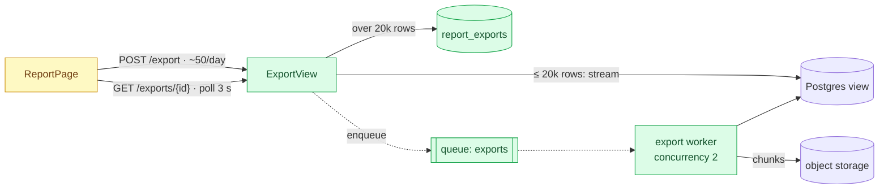

# Visualizing the architecture

**Read this file only after the user opted in** (picked 1 or 2 in the Step 6
question, or asked for a diagram themselves). Diagrams are never drawn by
default: they cost tokens the user may not want to spend.

A brief is read once; a diagram is looked at every time someone touches the
feature. When asked, the skill shows the proposed architecture in up to two
forms:

1. **In the terminal** — a box-drawing diagram of as-is and to-be, printed in
   the reply right before the brief, so the author sees the change at a glance
   without opening anything.
2. **In a generated design folder** — Mermaid sources plus a self-contained
   `architecture.html` that renders them in the browser, next to the brief, so
   the picture lives in the repo and is reviewed with the PR.

The diagrams carry the same facts as the brief. They never introduce a
component, an arrow or a number that the brief does not justify.

## What to produce at each depth

| User's choice | L2 | L3 |
| --- | --- | --- |
| **1** — terminal | as-is and to-be box diagrams (only to-be for a greenfield feature) | as L2, plus the one most important sequence (e.g. reconnect/resume) |
| **2** — terminal + folder | the above, plus `README.md` (brief), `as-is.mmd`, `to-be.mmd`, `architecture.html` | as L2, plus `flows/<name>.mmd` for each risky flow from the deep dive |
| **3** — no, or no answer | nothing | nothing |

L0 and L1 never get diagrams; the L1 design check may contain a one-line
text flow (`UI → GET /api/x → Service → Postgres`), which is not a diagram.

## 1. Terminal diagram

### Rules

- **Width ≤ 80 columns.** Terminals and PR comments wrap anything wider and
  the picture falls apart. If it does not fit, go top-to-bottom instead of
  left-to-right, or split into two diagrams (request path / async path).
- **Same names as the code.** Boxes are real modules, services, tables,
  queues, endpoints from Step 3. New things get the name they will have in
  the code.
- **Mark the change.** Suffix every box with a marker so the diff is visible
  without reading prose:
  - `+` new component
  - `~` changed component
  - `-` removed / replaced (as-is diagram only, or struck from to-be)
  - no marker — unchanged, shown only for context
- **Two arrow styles.** `──▶` synchronous call (caller waits), `╌╌▷` async
  hop (queue, pub/sub, event, job). Label arrows with the protocol or the
  endpoint, and with the load from Step 2 when it matters
  (`POST /export · 2 rps`, `fan-out ×2.5k`).
- **One legend line** under the diagram:
  `+ new  ~ changed  - removed  ──▶ sync  ╌╌▷ async`.
- **Group by boundary** when there is more than one deployable or trust zone:
  draw a dashed frame (`┌╌╌ worker pool ╌╌┐`) or simply a header line.
- **Keep it small.** 4-10 boxes. If you need more, the diagram is showing
  implementation detail; move it to the deep dive or to `flows/`.
- **Plain ASCII fallback.** If the user's terminal shows broken glyphs or they
  ask for ASCII, use `+--+`, `|`, `-->` and `..>` with the same rules.

### Characters

```
boxes      ┌ ┐ └ ┘ ─ │ ├ ┤ ┬ ┴ ┼
dashed     ╌ ╎
arrows     ──▶  ◀──  ╌╌▷  ◁╌╌  │ ▼ ▲
```

Draw inside a fenced code block with no language tag so the markdown
renderer keeps the spacing.

### Example — the CSV export brief from `brief-template.md`

```
AS-IS
┌────────────┐ GET /api/reports  ┌───────────────┐       ┌────────────────┐
│ ReportPage │ ────────────────▶ │ ReportService │ ────▶ │ Postgres view  │
└────────────┘                   └───────────────┘       └────────────────┘
               export.py stub: whole CSV in memory, 30 s proxy timeout

TO-BE
┌──────────────┐ POST /export · ~50/day ┌────────────────┐
│ ReportPage ~ │ ─────────────────────▶ │ ExportView +   │
└──────┬───────┘                        └───┬────────┬───┘
       │                         ≤ 20k rows │        │ > 20k rows
       │                                    ▼        ▼
       │                 ┌──────────────────────┐ ┌──────────────────────┐
       │                 │ stream CSV (200)     │ │ report_exports +     │
       │                 │ iter_rows by cursor  │ │ status=queued        │
       │                 └──────────────────────┘ └──────────┬───────────┘
       │                                                     ╎ enqueue
       │                                                     ▽
       │ GET /exports/{id} · poll 3 s           ┌──────────────────────┐
       ├──────────────────────────────────────▶ │ export worker +      │
       │                                        │ queue "exports", ×2  │
       │                                        └──────────┬───────────┘
       │                                                   │ chunks
       │ signed URL, 1 h                                   ▼
       └──────────────────────────────────────▶ ┌──────────────────────┐
                                                │ object storage       │
                                                └──────────────────────┘
+ new  ~ changed  - removed  ──▶ sync  ╌╌▷ async
```

## 2. The design folder

### Where

1. If the repo already keeps design docs (`docs/adr/`, `docs/design/`,
   `docs/architecture/`, `docs/rfcs/`, `adr/`, `rfcs/`), use that folder and
   follow its naming scheme.
2. Otherwise create `docs/design/<YYYY-MM-DD>-<feature-slug>/`.
3. If the user asked for the brief at a specific path (e.g. `design-brief.md`),
   write the brief there exactly as asked and put the diagrams folder next to
   it as `<brief-name>.design/` (e.g. `design-brief.design/`); link to it from
   the brief.

Say the path in one line of the reply so the user can open it.

### Layout

```
docs/design/2026-11-05-employees-csv-export/
├── README.md          the brief; as-is and to-be embedded as ```mermaid blocks
├── as-is.mmd          Mermaid source, current design
├── to-be.mmd          Mermaid source, proposed design
├── flows/             L3 only: one sequence diagram per risky flow
│   └── reconnect-resume.mmd
└── architecture.html  open in a browser: tabs for as-is / to-be / flows
```

`README.md` renders on GitHub and GitLab with the diagrams inline. The `.mmd`
files are the source of truth for the pictures: `README.md` and
`architecture.html` contain copies of them, so update all three together.
Anyone who wants PNG/SVG can run `npx @mermaid-js/mermaid-cli -i to-be.mmd -o to-be.svg`;
do not generate images yourself unless asked.

### Mermaid conventions

- `flowchart LR` for architecture (switch to `TB` when there are more than ~5
  boxes in a row), `sequenceDiagram` for flows.
- Node ids in `camelCase`; labels are the real names, with a second line for
  the key detail: `exportWorker["export worker<br/>queue: exports ×2"]`.
- Shapes: `[(name)]` database/storage, `[[name]]` queue/topic,
  `([name])` external actor or third party, `[name]` service/module.
- Arrows: `-->` sync, `-.->` async; labels with `-->|POST /export|`.
- Group deployables with `subgraph`.
- Mark the change with classes, the same meaning as the terminal markers:



Put the three `classDef` lines in every architecture diagram, even when a
class is unused, so the files stay uniform.

Quote labels that contain `/`, `{`, `(`, `·`, `<` or `>`: `-->|"GET /x/{id}"|`.
Unquoted special characters are the most common reason a Mermaid diagram
fails to render. Do not start a label with `>`, `-`, `#` or `1.`: Mermaid
reads it as markdown (`"> 20k rows"` becomes a blockquote) — write
`"over 20k rows"`.

### `architecture.html`

Copy `assets/architecture.html` from this skill into the design folder and
fill the placeholders:

| Placeholder | Value |
| --- | --- |
| `{{TITLE}}` | feature name, plain text |
| `{{SUBTITLE}}` | `Depth L2 · proposal · 2026-11-05` |
| `{{SUMMARY}}` | 1-3 sentences: the chosen shape and why (the brief's section-4 conclusion) |
| `{{AS_IS}}` | contents of `as-is.mmd` |
| `{{TO_BE}}` | contents of `to-be.mmd` |
| `{{FLOWS}}` | zero or more `<script type="text/x-mermaid" data-title="Reconnect / resume">…</script>` blocks, one per file in `flows/`; empty for L2 |

Mermaid source goes inside `<script type="text/x-mermaid">` tags, so no HTML
escaping is needed; just never write the literal text `</script>` inside a
diagram. HTML-escape `{{TITLE}}`, `{{SUBTITLE}}` and `{{SUMMARY}}` (`&`, `<`,
`>`). The page loads Mermaid from a CDN; offline it falls back to showing the
source text, which is still readable.

Do not open a browser or start a server. Tell the user the file path; they
open it themselves.

## 3. Self-check before showing

- Every box in the to-be is either in the as-is or explained in the brief's
  section 4.
- Every `+` and `~` marker matches a step in the implementation plan.
- Arrow directions follow the request, not the dependency (caller → callee,
  producer ╌╌▷ queue ╌╌▷ consumer).
- The terminal diagram fits 80 columns: check the longest line.
- The `.mmd`, `README.md` and `architecture.html` copies are identical.
